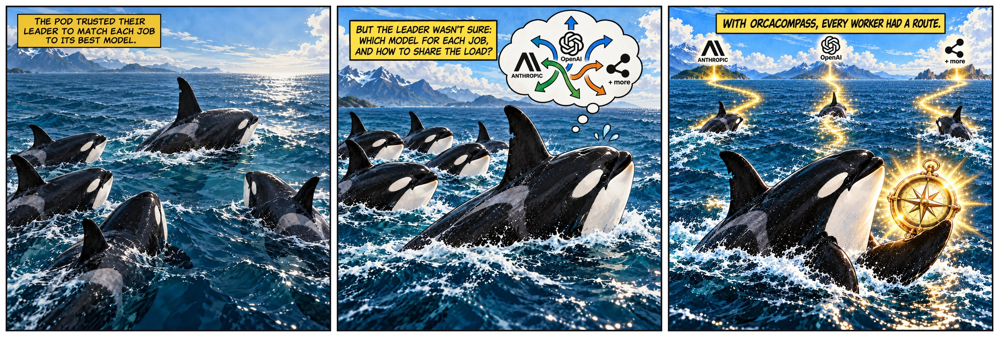

<div align="center">

# OrcaCompass

**Help your orchestrator pick the right model for every job.**

<p>

</p>

[](LICENSE)
[](package.json)
[](#install)

[Install](#install) · [Quick start](#quick-start) · [User guide](docs/README.md) · [Commands](docs/commands.md) · [Troubleshooting](docs/troubleshooting.md) · [Contributing](CONTRIBUTING.md)

</div>

An [Orca](https://github.com/stablyai/orca) orchestrator that hands a job to a
worker has to pick an agent, a model and a reasoning effort. On its own it
cannot tell which of your installed models suits the job, or how much of each
plan's usage is left before the limits reset. OrcaCompass makes that choice:
the orchestrator rates how hard the job is, and OrcaCompass compares the
installed Claude Code, Codex, Cursor, Grok Build, Antigravity and OpenCode
routes using model metadata and current usage limits, explains its choice, and
returns launch arguments. The orchestrator still launches the worker. It ships
as an Agent Skill backed by a small TypeScript CLI.

## How it works

1. **The orchestrator rates the job** as one of four difficulty tiers.
2. **OrcaCompass finds what you can actually use:** installed agent CLIs that
   you have enabled in Orca and not switched off in OrcaCompass, their models,
   and current usage from Orca.
3. **It keeps only models that fit the tier,** then prefers the one with the
   most headroom: the share of its usage window expected to be left unused at
   reset. Nearly exhausted windows are skipped.
4. **It returns a route** (agent, model, effort) with the reasons and ready-made
   launch arguments.

| Tier | What it means | Typical job | Default effort |
| --- | --- | --- | --- |
| `light` | Mechanical; a mistake is cheap and easy to see | Renames, config values, summaries, lookups | `low` |
| `daily` | Ordinary engineering without a written plan | Features in a few files, reproducible bugs, tests | `medium` |
| `advanced` | Needs a plan; mistakes are costly or subtle | Cross-cutting refactors, races, schema changes, security | `medium` |
| `frontier` | The edge of what models can do | Novel algorithms, failures Advanced could not solve | `high` |

## Install

Use **Node.js 24** for the simplest setup. The published CLI also runs on
Node.js 20+, but reading Orca's agent switches requires Node.js 22.13+ without
extra flags; otherwise those switches are reported as `unknown`.
You also need the agent CLIs you want to route to installed and signed in,
and Orca running for live usage data.

### One-command install

```sh
npx orcacompass install --global
```

One command installs the CLI and the matching Skill for your user. Add
`--agent <name>` to choose which agents receive the Skill, or `--yes` to accept
the installer's defaults. For a project-local Skill instead, run it without
`--global` in that project.

### Alternative: install the CLI, then the Skill

```sh
npm install -g orcacompass
orcacompass install --skill-only --global
```

This installs the same published CLI and matching Skill in two steps.

### Alternative: build from source

To use the current `main`, use Node.js 24 and npm for the development tools:

```sh
git clone https://github.com/manomilano/orca-compass.git
cd orca-compass
npm ci
npm install -g .
orcacompass install --skill-only --global
```

See [Getting started](docs/getting-started.md#install) for details. Keep Orca's
own orchestration skill installed alongside it. To work on OrcaCompass itself,
see [CONTRIBUTING.md](CONTRIBUTING.md).

## Quick start

```sh
orcacompass setup
```

`setup` asks three short questions in the terminal (which agents to use,
optional favorite routes per tier, models never to use), then shows the
result with an example route per tier and saves it once you confirm. Press
Enter to keep any answer; running it again starts from your current settings.
With the Skill installed you can also just ask your orchestrator to "set up
OrcaCompass": it asks the same questions in chat (and offers to before your
first route).

Everything `setup` does is also a command of its own:

```sh
orcacompass status                        # agents, usage, and the pick for each tier
orcacompass tiers                         # every model's tiers, with the numbers behind them
orcacompass agents                        # which agents are used, and why not
orcacompass agents disable grok           # never route to Grok Build
orcacompass prefer daily codex            # Codex first for everyday jobs, unless it runs too hot
orcacompass ban claude-haiku              # never route a Claude Haiku model
orcacompass route --tier daily --json     # a route for an everyday job
orcacompass route --tier advanced --agent claude --agent codex --demand high
orcacompass route --tier frontier --no-downgrade --json   # never fall back to a lower tier
```

With the Skill installed, the orchestrator does this for you: it rates each
job, calls `orcacompass route`, and launches the worker with the returned
arguments:

```sh
orca orchestration worker-start --spec "<actual task>" --agent claude --model claude-opus-5-5 --effort medium
```

Only `status: "ok"` carries a route. Pass `launchArgs` as separate, properly
quoted arguments together with your usual Orca worktree and lifecycle options.
OrcaCompass never launches workers itself.

For example, a routing decision can look like this (illustrative numbers):

```text
$ orcacompass route --tier advanced
advanced → claude · claude-opus-5-5 · medium (high confidence)
  claude claude-opus-5-5: weekly 40% used, 62% of window elapsed (headroom 34%) → on pace for 65% before reset in 2d
```

## User guide

Start with [Getting started](docs/getting-started.md), or browse the
[complete user guide](docs/README.md).

| Learn about | Read |
| --- | --- |
| Every command, flag, exit code and JSON response | [Commands](docs/commands.md) |
| Preferences, bans, paths and defaults | [Configuration](docs/configuration.md) |
| How routes are ranked and how fallbacks work | [Tiers and routing](docs/tiers-and-routing.md) |
| Reasoning demand and supported effort levels | [Effort](docs/effort.md) |
| How the orchestrator routes, launches and verifies | [Skill workflow](docs/skill-workflow.md) |
| Checking that a worker's agent accepted its model | [Verify and rejections](docs/verify-and-rejections.md) |
| Supported agents and where their models come from | [Models and agents](docs/models-and-agents.md) |
| What to do when an agent is not used or a route fails | [Troubleshooting](docs/troubleshooting.md) |
| Planned work and known limitations | [Roadmap](docs/roadmap.md) |
